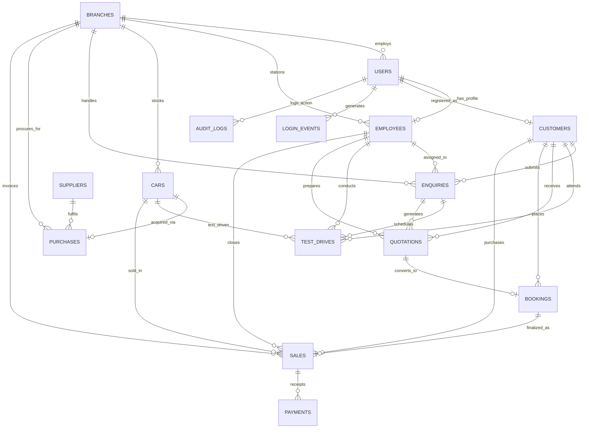

# Car Dealership Management System (CDMS) — Database Reference & Architecture

This document provides a comprehensive, student-friendly reference for the local MySQL database powering the Car Dealership Management System (CDMS).

---

## 1. Quick Start: Visual Database Inspection

You have **three simple ways** to visually inspect all tables, relationships, and live data in the `cdms` database:

### Option A: Drizzle Studio (Browser GUI — Recommended)
Run this command in your project terminal:
```bash
bun run db:studio
```
Then open `https://local.drizzle.studio` in your web browser. You can:
- Browse all 16 tables in an interactive graphical spreadsheet.
- Filter, sort, add, edit, or delete records.
- Inspect foreign key relationships in real-time.

### Option B: Built-in Owner Database Explorer (Inside Web App)
1. Sign in as the Dealership Owner (`owner@cdms.local` / `Dealership@2026`).
2. Navigate to the **Database Explorer** tab in the Owner Dashboard (`/owner`).
3. You can click on any table (e.g., `cars`, `enquiries`, `sales`, `audit_logs`) to view column types, row counts, and live records with sensitive passwords sanitized.

### Option C: MySQL Workbench / Command Line
1. Open **MySQL Workbench** on Windows.
2. Connect to Local instance (`localhost:3306`, User: `root`, Password: your root password).
3. Expand `Schemas` > `cdms` > `Tables`. Right-click any table and choose **Select Rows - Limit 1000**.
4. Or in terminal:
```bash
mysql -u root -p cdms
SHOW TABLES;
SELECT * FROM branches;
```

---

## 2. Entity-Relationship Diagram (ERD)

The relational schema is normalized into 16 core business tables with foreign keys and cascade rules enforcing referential integrity.



---

## 3. Core Database Tables & Data Dictionary

| # | Table Name | Purpose | Primary Key | Key Foreign Keys |
|---|---|---|---|---|
| 1 | `branches` | Dealership showrooms across India (Pune, Mumbai, Bengaluru) | `id` (UUID) | None |
| 2 | `users` | Local authentication accounts with bcrypt hashed passwords | `id` (UUID) | `branch_id` -> `branches.id` |
| 3 | `user_roles` | Compatibility role assignments | `id` (UUID) | `branch_id` -> `branches.id` |
| 4 | `customers` | Prospective and verified buyers with KYC details | `id` (UUID) | `user_id` -> `users.id` |
| 5 | `employees` | Sales Executives & Branch Managers | `id` (UUID) | `user_id` -> `users.id`, `branch_id` -> `branches.id` |
| 6 | `cars` | Individual physical inventory vehicles with VIN & pricing | `id` (UUID) | `branch_id` -> `branches.id`, `transfer_to` -> `branches.id` |
| 7 | `suppliers` | Automobile OEMs & Manufacturers (Tata, Hyundai, etc.) | `id` (UUID) | None |
| 8 | `enquiries` | Customer demand requests, leads, and bookings | `id` (UUID) | `customer_id`, `employee_id`, `car_id`, `branch_id` |
| 9 | `test_drives` | Scheduled customer vehicle trials | `id` (UUID) | `enquiry_id`, `customer_id`, `car_id` |
| 10 | `quotations` | Price estimates with GST (28%), RTO (10%), Insurance (3.5%) | `id` (UUID) | `enquiry_id`, `customer_id`, `car_id`, `branch_id` |
| 11 | `bookings` | Customer bookings with token payment & order status | `id` (UUID) | `quotation_id`, `customer_id`, `car_id`, `branch_id` |
| 12 | `sales` | Final sales invoices, on-road prices, and revenue | `id` (UUID) | `customer_id`, `employee_id`, `car_id`, `branch_id` |
| 13 | `purchases` | Manufacturer procurement orders triggered by customer demand | `id` (UUID) | `supplier_id`, `car_id`, `branch_id`, `enquiry_id` |
| 14 | `accessories_catalogue` | Genuine add-ons and accessories | `id` (UUID) | None |
| 15 | `payments` | Customer payment receipts (Cash, UPI, NEFT, Cheque) | `id` (UUID) | `sale_id`, `customer_id`, `branch_id` |
| 16 | `audit_logs` | Immutable audit trail of every critical financial/state change | `id` (UUID) | `branch_id` -> `branches.id` |
| 17 | `login_events` | Security access log with IP, user-agent, and status | `id` (UUID) | `branch_id` -> `branches.id` |

---

## 4. State Machines and Business Workflows

The backend strictly enforces the following allowed state transitions via `src/server/permissions.ts`. Multi-step operations run inside atomic MySQL database transactions (`db.transaction`).

### A. Customer Demand & Enquiry Lifecycle
```text
NEW ───► CONTACTED ───► TEST_DRIVE ───► QUOTED ───► BOOKED ───► CLOSED_WON (Delivered)
  │            │              │             │
  └────────────┴──────────────┴─────────────┴─────► CLOSED_LOST (Cancelled)
```
- **Invariants**:
  - Enquiries cannot jump from `NEW` directly to `BOOKED` without quotation and branch assignment.
  - A test drive cannot be double-booked for the same car or time slot.

### B. Demand-Driven Procurement Lifecycle
Instead of stocking hundreds of idle cars, unstocked customer demand triggers a Purchase Order (PO) to the OEM.
```text
REQUESTED ───► MANAGER_APPROVED ───► OWNER_APPROVED ───► ORDERED ───► IN_TRANSIT ───► RECEIVED ───► ALLOCATED
     │                   │                   │
     ▼                   ▼                   ▼
 REJECTED            REJECTED            CANCELLED
```
- **Invariants**:
  - Branch Manager approves local demand feasibility.
  - Dealership Owner approves capital expenditure and releases the PO to the OEM.
  - Upon `RECEIVED`, the car enters the branch inventory and is immediately `ALLOCATED` to the customer's booking.

### C. Car Physical Inventory Status
```text
IN_TRANSIT ───► IN_STOCK ───► RESERVED ───► SOLD ───► DELIVERED
```
- **Invariants**:
  - Cars with status `RESERVED` or `SOLD` cannot be assigned to another quotation or test drive.
  - Inter-branch transfers place the car into `IN_TRANSIT` with `transfer_to` set until approved by the Owner.

### D. Customer Payment Status
```text
PENDING ───► PARTIAL ───► PAID ───► REFUNDED
```
- **Invariants**:
  - Delivery checklist signoff cannot occur until payment status is `PAID` or a bank hypothecation / loan approval letter is on file.

---

## 5. Role-Based Scoping & Security Matrix

MySQL has no native Row Level Security (RLS), so all security checks are validated on the server before querying:

| Feature / Permission | OWNER | BRANCH_MANAGER | EMPLOYEE (Sales Exec) |
|---|---|---|---|
| **Branch Scope** | All Branches | Assigned Branch Only | Assigned Branch Only |
| **Manage Branches** | Yes | No | No |
| **Manage Staff & Roles** | Yes | No | No |
| **Create Enquiries & Leads** | Yes | Yes | Yes (Self-assigned) |
| **Schedule Test Drives** | Yes | Yes | Yes |
| **Generate Quotations** | Yes | Yes | Yes |
| **Approve Discounts (>₹25k)**| Yes | Yes (Up to ₹50k) | No (Requires approval) |
| **Approve Procurement POs** | Yes (Final release) | Yes (Initial review)| No |
| **Record Payments** | Yes | Yes | Yes |
| **View Audit & Login Logs** | Yes | No | No |
| **Database Explorer** | Yes | No | No |

---

## 6. Schema Backup and Migration Commands

- **Generate new migration**: `bun run db:generate`
- **Apply migrations**: `bun run db:migrate`
- **Re-seed sample data**: `bun run db:seed`
- **Create new Owner account**: `bun run create-owner`
- **Export full SQL dump**: `bun run db:dump` (creates `database.sql`)
